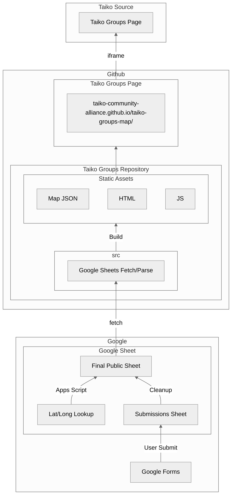

# Taiko Groups Map
This project hosts the code and data used in the Taiko Groups map as seen on https://www.taikosource.org/.
It uses data collected by the Taiko Community Alliance from user submisssions and various sources.

## Looking to Update or Add Data?
The groups that are shown on this map are managed by Taiko Community Alliance volunteers. If you want to add your group or update your group's information, just fill out this form here: https://docs.google.com/forms/d/e/1FAIpQLSesYmefC6XYIYyQ-JqY4bUnQvMnHF84CCZqWgH9OGmEOEz3LA/viewform

## Libraries Used
 - [Leaflet.js](https://github.com/Leaflet/Leaflet)
 - [Leaflet Map Clustering](https://github.com/Leaflet/Leaflet.markercluster)
 - [Leaflet SidePanel](https://github.com/cyclingbyte/Leaflet.SidePanel)

## Build Workflow and Hosting
The following flow chart outlines how the Taiko Groups Map is generated, built, and hosted on Taiko Source.

## TODO

### Nice to Have
 
 - [x] Include group website
 - [x] Search-able
 - [x] Improve styles/UX for side panel
 - [x] Custom Map Markers
 - [x] Work out UI bugs with sidepanel/clicking
 - [ ] Show groups out of view at the bottom of list
 - [ ] Include group contact info
 - [ ] Regional markers/colors
 - [ ] Images from groups? Logos or photos?
 - [ ] Include group estaablished years
